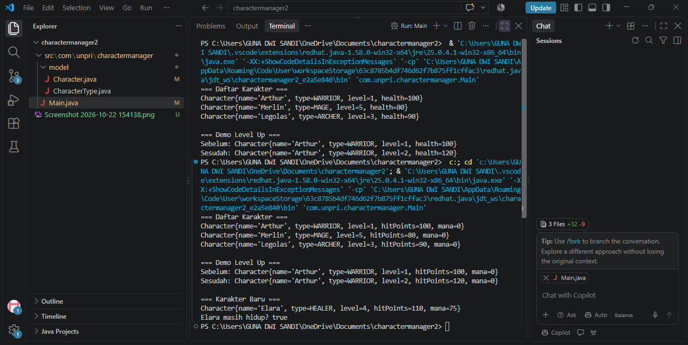

Character Manager – TP3 (Java Visual SIH-6406)

Deskripsi
Aplikasi Character Manager merupakan program berbasis Java yang digunakan untuk mengelola data karakter dalam sebuah game. Program menerapkan konsep Object-Oriented Programming (OOP) seperti encapsulation, inheritance, dan polymorphism. Pengguna dapat menambah, melihat, serta mengelola informasi karakter melalui antarmuka berbasis terminal.

Screenshot Output Terminal

Hasil Program
CharacterManager-TP3/
│
├── src/
│   ├── model/
│   │   ├── Character.java
│   │   ├── Hero.java
│   │   └── Enemy.java
│   │
│   ├── controller/
│   │   └── CharacterManager.java
│   │
│   ├── view/
│   │   └── Main.java
│   │
│   └── utils/
│       └── Helper.java
│
├── images/
│   ├── output-terminal.png
│   └── isalive-output.png
│
└── README.md

Identitas Mahasiswa
Nama : Luna Tri Sandi
NIM : 253303621240
Google Docs Bagian D : https://1drv.ms/w/c/265fce39944988d2/IQBSaEjTa1-HRouFOAIbQDK6Ab6l14r5AjI12270OtqmmGg?e=NbOzfn

______________________________________________________________________________________________________________

Character Manager — TP5 (Java Visual SIH-6406)

Deskripsi
Character Manager adalah aplikasi Java berbasis Object Oriented Programming (OOP) untuk mengelola data karakter game. Program ini mendukung penambahan karakter, pencarian berdasarkan nama dan tipe, penghapusan karakter, perhitungan rata-rata level, serta fitur analitik untuk mencari karakter dengan attack power tertinggi. Implementasi juga menerapkan konsep encapsulation, constructor, enum, collection ArrayList, dan validasi data.

Screenshot Output

Hasil Program
charactermanager-TP5/
│
├── src/
│   │
│   └── com/
│       └── unpri/
│           └── charactermanager/
│               │
│               ├── CharacterManager.java
│               ├── Main.java
│               │
│               └── model/
│                   ├── Character.java
│                   └── CharacterType.java
│
├── Screenshot/
│   └── TP5.png
│
└── README.md

Identitas Mahasiswa

Nama Lengkap: [Luna Tri Sandi]
NIM: [253303621240]
Link Google Docs (Bagian D):https://1drv.ms/w/c/265fce39944988d2/IQBhCxH4lz9DSb6pL-5FAL0sAfvzjrUEsdZ8RusYiMvnTYs?e=NRoXvR

________________________________________________________________________________________________________

Character Manager — TP8 (Java Visual SIH-6406)

Deskripsi Proyek

Character Manager TP8 adalah aplikasi desktop berbasis Java Swing yang digunakan untuk mengelola dan menampilkan data karakter game dalam antarmuka GUI (Graphical User Interface). Aplikasi ini menerapkan konsep Object-Oriented Programming (OOP) seperti class, object, encapsulation, enum, serta penggunaan collection ArrayList untuk menyimpan data karakter.

Program dikembangkan menggunakan pola arsitektur MVC (Model-View-Controller). Data karakter disimpan pada Model (Character dan CharacterType), dikelola oleh Controller (CharacterManager), dan ditampilkan melalui View (MainWindow). Aplikasi menampilkan daftar karakter secara dinamis, menghitung rata-rata level karakter, serta menyediakan fitur penambahan karakter baru melalui antarmuka GUI.

struktur foldernya

CharacterManager/
│
├── screenshots/
│   ├── tp8-sebelum.png
│   └── tp8-sesudah.png
│
├── src/
│   └── com/
│       └── unpri/
│           └── charactermanager/
│               │
│               ├── Main.java
│               ├── CharacterManager.java
│               │
│               ├── model/
│               │   ├── Character.java
│               │   └── CharacterType.java
│               │
│               └── view/
│                   └── MainWindow.java
│
└── README.md

Fitur Aplikasi
Aplikasi Character Manager memiliki beberapa fitur utama, yaitu:

Menampilkan daftar karakter dalam antarmuka GUI (Java Swing).
Menampilkan informasi karakter berupa nama, tipe, level, dan attack power.
Menyimpan data karakter menggunakan ArrayList.
Menambahkan karakter baru melalui tombol "Tambah Karakter".
Menghitung dan menampilkan rata-rata level seluruh karakter secara otomatis.
Memperbarui statistik rata-rata level ketika data karakter berubah.
Menggunakan perulangan (loop) untuk menampilkan data karakter secara dinamis.
Menerapkan arsitektur MVC (Model-View-Controller).
Menggunakan enum CharacterType untuk mengelompokkan tipe karakter (WARRIOR, MAGE, ARCHER).
Menjalankan GUI menggunakan SwingUtilities.invokeLater() sesuai best practice Java Swing.

Data Karakter

Pada aplikasi Character Manager, terdapat enam karakter yang digunakan sebagai data awal untuk ditampilkan pada GUI. Karakter pertama adalah Arjuna, seorang bertipe Warrior dengan level 5 dan attack 30 yang berperan sebagai petarung utama. Karakter kedua adalah Srikandi, bertipe Archer dengan level 3 dan attack 20 yang memiliki kemampuan serangan jarak jauh.

Karakter ketiga adalah Bima, seorang Warrior dengan level 7 dan attack 40. Karakter ini memiliki nilai attack tertinggi sehingga menjadi salah satu karakter terkuat dalam daftar. Karakter keempat adalah Gatotkaca, juga bertipe Warrior, dengan level 6 dan attack 35 yang memiliki keseimbangan antara kekuatan dan daya tahan.

Selain itu terdapat dua karakter bertipe Mage, yaitu Cempaka dan Maharani. Keduanya memiliki level 4 dan attack 25. Penambahan karakter bertipe Mage dilakukan untuk memberikan variasi tipe karakter sehingga data dalam aplikasi menjadi lebih beragam dan menarik untuk dianalisis.

Seluruh karakter tersebut digunakan untuk menghitung statistik Rata-rata Level, yang ditampilkan pada bagian bawah jendela aplikasi. Dengan enam karakter yang tersedia, rata-rata level yang diperoleh adalah 4,83. Statistik ini akan berubah secara otomatis apabila karakter baru ditambahkan atau level karakter diubah.

Perhitungan Rata-rata Level
Nama KarakterLevelArjuna5Srikandi3Bima7Gatotkaca6Cempaka4Maharani4

Aliran Data dan Konsep MVC

Pada aplikasi Character Manager, aliran data dimulai saat program dijalankan melalui class Main. Class ini bertugas membuka jendela utama (MainWindow) menggunakan SwingUtilities.invokeLater(). Setelah jendela ditampilkan, MainWindow akan meminta data karakter kepada CharacterManager.

CharacterManager berfungsi mengelola seluruh data karakter yang tersimpan di dalam ArrayList. Data karakter tersebut berasal dari class Character yang menyimpan informasi seperti nama, tipe karakter, level, dan attack. Setelah data diterima dari CharacterManager, MainWindow akan menampilkan informasi tersebut ke dalam komponen GUI seperti JLabel, JTextArea, atau komponen tampilan lainnya.

Ketika pengguna menekan tombol Tambah Karakter, data baru akan dikirim dari MainWindow ke CharacterManager. Selanjutnya CharacterManager menyimpan data baru ke dalam daftar karakter, lalu MainWindow melakukan refresh tampilan sehingga data terbaru dapat langsung terlihat oleh pengguna.

Screenshoot hasil output

Sebelum Data Diubah 
[text](model/Character.java)

Sesudah Data Diubah
[text](model/Character.java)

Nama Lengkap: [Luna Tri Sandi]
NIM: [253303621240]
Link Google Docs (Bagian D):https://1drv.ms/w/c/265fce39944988d2/IQC1HpyTXEGJSZtj5abKaZnNAaQMmCg2ibE5ieK2FtdOLvI?e=GvE5Tp